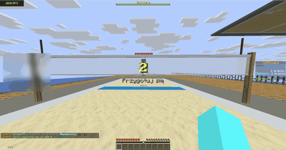
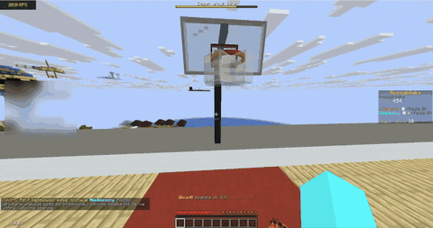
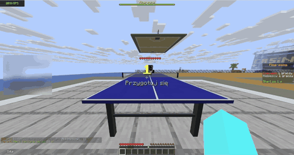
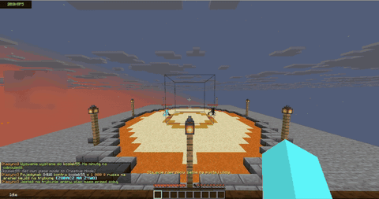
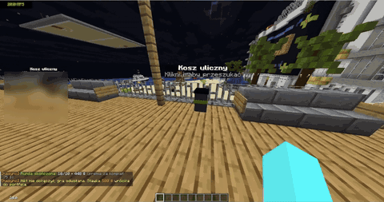
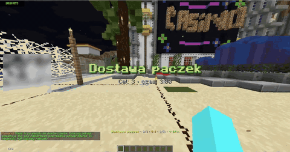

# Kasyno, ekonomia i sport na serwer Minecraft

To mój projekt na serwer Minecraft (Paper 1.21.11). Są w nim trzy rzeczy: plugin z kasynem i ekonomią, plugin ze sportem (siatkówka, koszykówka, ping-pong) i bot na Discorda z tą samą ekonomią.

Pluginy są w Javie 21, bot w Node.js. Plugin z kasynem ma 405 testów, ten ze sportem około 260. Niżej kilka nagrań z mojego serwera.

## Jak to wygląda

| | |
|---|---|
| <br>Siatkówka: zagrywka, odbicia, atak, punkty | <br>Koszykówka: rzuty, faule, wsady, zegar akcji |
| <br>Ping-pong: stół z siatką, serwis i wymiana | <br>Pojedynek na arenie: odliczanie i walka o stawkę |
| <br>Rekin: im dalej od brzegu, tym większe ryzyko, najpierw widać płetwę | <br>Śmietniki z bloków, każdy ma własną przerwę |
| <br>Kurier: dostarczanie paczek po mieście | |

Poza tym są okna gier z własnymi tłami i ikonami (moneta, sloty, ruletka, plinko, crash i inne) oraz stoły na żywo.

## Co jest w repo

| Folder | Co to jest |
|---|---|
| [`minecraft-plugin/`](minecraft-plugin/README.md) | Kasyno i ekonomia, plugin Paper (ok. 23 tys. linii Javy i 10 tys. linii testów) |
| [`sport-plugin/`](sport-plugin/README.md) | siatkówka, koszykówka i ping-pong (ok. 8 tys. linii i 5 tys. linii testów) |
| `src/` i `test/` | bot Discord, opis w [`docs/discord-bot.md`](docs/discord-bot.md) |
| [`docs/`](docs) | dokumentacja, m.in. [architektura](docs/ARCHITEKTURA.md) |

## Co to potrafi

Kasyno i ekonomia: portfel, bank z odsetkami, sklep ze 113 przedmiotami, poziomy, biznesy z dochodem pasywnym, farma, skrzynie i loteria. Gier jest 14 solo w oknach (moneta, sloty, zdrapka, kości, blackjack, hi-lo, miny, Chicken Road, wieża, plinko, limbo, rewolwer, szansa i kamień-papier-nożyce) i cztery stoły na żywo, przy których jedna runda jest wspólna dla wszystkich (crash, ruletka, koło, wyścigi). Do tego jackpot, napad i pojedynki.

W samym świecie gry:

* napad na bank: ekipa wchodzi do banku w skórkach prawdziwych graczy, etapy losuje scenariusz, a złapani idą do więzienia
* arena: pojedynki i jackpot jako pokaz z figurami graczy, odliczaniem i fajerwerkami dla zwycięzcy
* prace od NPC: grzyby, kopalnia, ryby, sprzątanie, paczki, a cele świecą w świecie
* śmietniki, z których zbiera się łup
* waypointy z nazwą i odległością, które widać przez ściany. Można dać nagrodę za odkrycie miejsca, ustawić dom i dostać znacznik miejsca śmierci
* więzienie: po nieudanym przestępstwie albo napadzie trafia się do jednej z trzech cel i wychodzi się przez minigierki (podkop, refleks, sekwencja, egzamin)
* rekin: im dalej od brzegu pływasz, tym większa szansa, że podpłynie. Najpierw masz kilka sekund na wyjście z wody, potem rekin gryzie i tracisz połowę gotówki z portfela

Sport to osobny plugin: siatkówka (zagrywka, odbicie, wystawienie, atak, blok), koszykówka (rzuty, faule, rzuty osobiste, wsad, zabieranie piłki) i ping-pong. Piłka leci według fizyki, z oporem powietrza i odbiciami, a graczem steruje się myszą.

## Jak to jest zrobione

Więcej jest w [docs/ARCHITEKTURA.md](docs/ARCHITEKTURA.md), a tutaj najważniejsze rzeczy:

* logika gier, fizyka i scenariusze (napad, atak rekina, wyrok) są oddzielone od Bukkita, więc da się je testować bez uruchamiania Minecrafta
* testy idą na atrapie serwera (MockBukkit). Pieniądze muszą się w nich zgadzać co do monety, a każda gra ma sprawdzony zwrot poniżej 100%
* stawka jest pobierana i rozliczana, zanim ruszy animacja. Po awarii serwera stawki z przerwanych gier wracają do graczy
* ustawienia są w `config.yml` z komentarzami. Po aktualizacji stare configi i zapisy graczy dalej działają
* w repo nie ma żadnych sekretów, token bota jest tylko w lokalnym `.env`
* paczkę zasobów (tła okien, ikony, karty 3D) generują skrypty w Node.js

## Uruchomienie

Plugin: gotowy plik `.jar` jest w zakładce Releases. Wrzuca się go do `plugins/` (Paper 1.21.11, Java 21). Można też zbudować samemu:

```bash
cd minecraft-plugin
mvn package
```

Szczegóły i komendy są w [`minecraft-plugin/README.md`](minecraft-plugin/README.md) i [`sport-plugin/README.md`](sport-plugin/README.md). Plugin ze sportem zastępuje starszy `SiatkowkaPlugin`, więc nie wrzucaj ich razem.

Bot Discord (Node.js 22.13 lub nowszy):

```bash
npm install
npm run setup
npm run deploy
npm start
```

`npm run setup` zapyta o token i zapisze go w lokalnym `.env`, który nie trafia do gita. Więcej w [`docs/discord-bot.md`](docs/discord-bot.md).

## Co jest sprawdzone, a co nie

Nagrania są z działającego serwera: sport, arena, śmietniki, kurier, rekin i okna gier. Napad na bank w świecie, więzienie i waypointy z nagrodami mają na razie tylko testy na atrapie serwera, na żywo jeszcze ich nie widziałem. Nie sprawdzałem też, jak to działa przy dużej liczbie graczy naraz.

## Kto to pisał

Kod w większości pisze Claude Code (asystent AI). Ja mówię, co ma działać, sprawdzam to na serwerze i zgłaszam poprawki.

Autor: fr0zenowy
